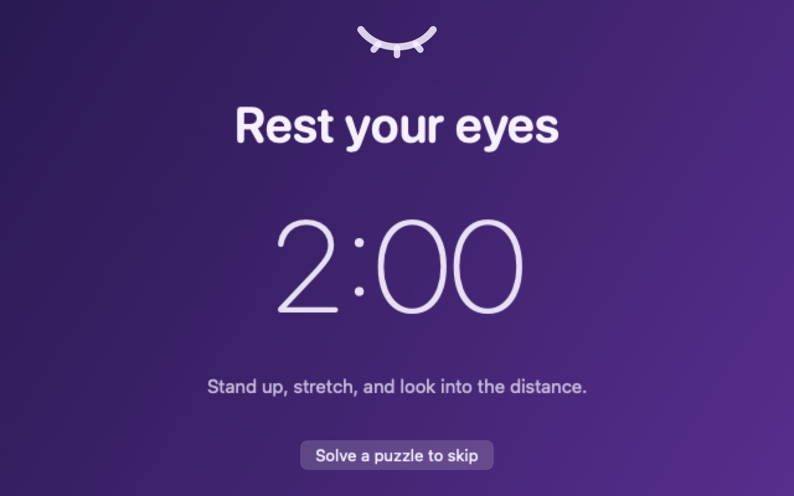
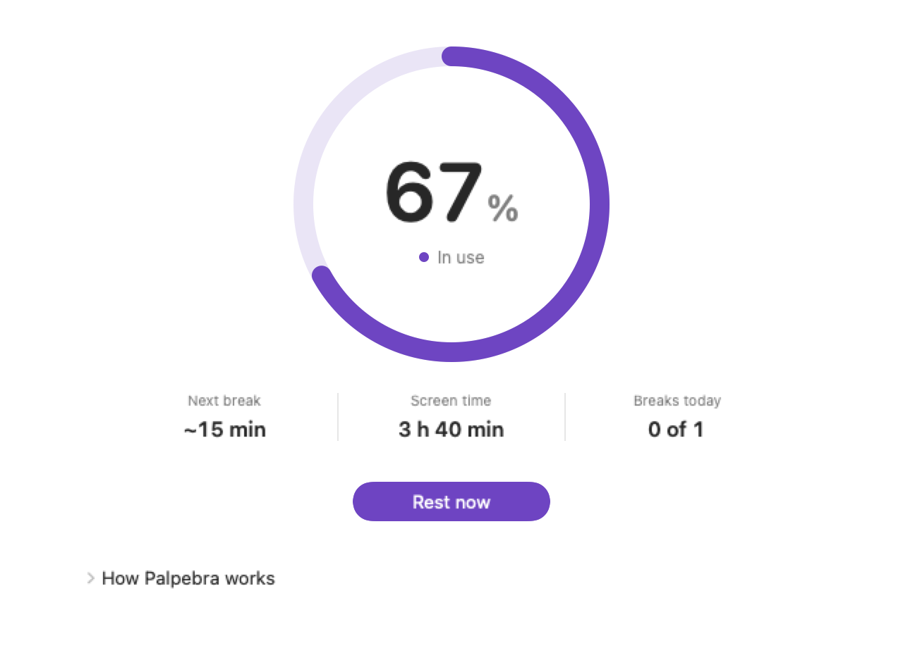
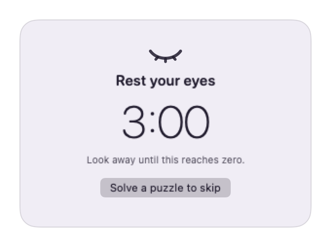
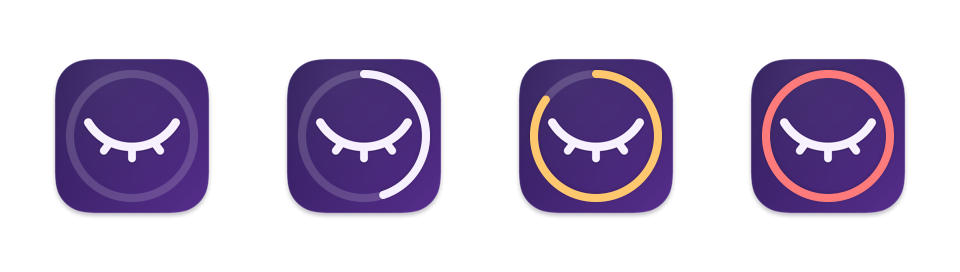
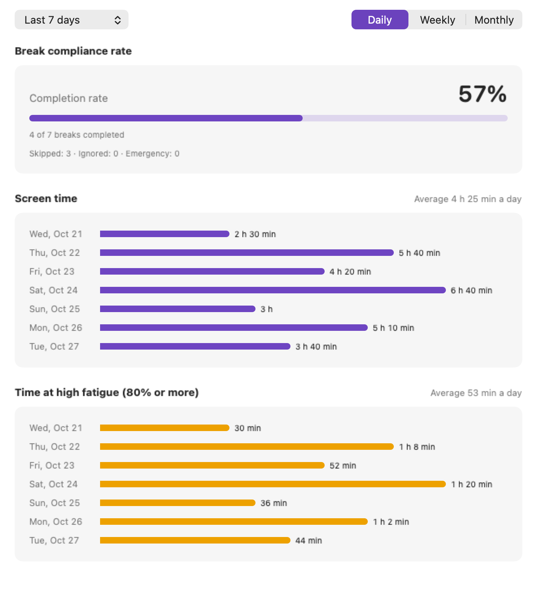
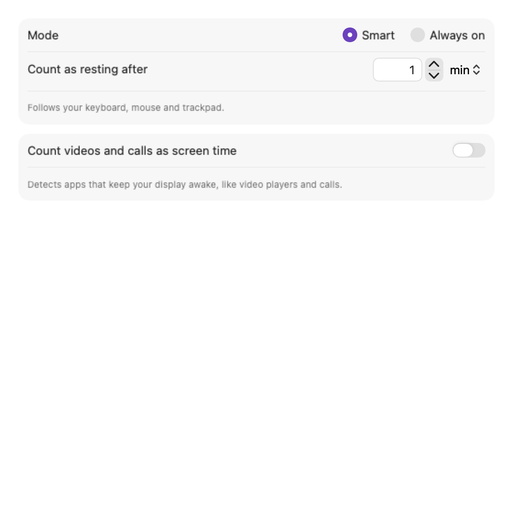

# Palpebra

A small menu-bar app for macOS that reminds you to rest your eyes. It notices how long you've been using your Mac and tells you when it's time to look away.

[](https://github.com/jasonwong2001/palpebra/actions/workflows/ci.yml)
[](LICENSE)


<picture>
  <source media="(prefers-color-scheme: dark)" srcset="docs/images/overlay-fullscreen-dark.jpg">
  <source media="(prefers-color-scheme: light)" srcset="docs/images/overlay-fullscreen-light.jpg">
  
</picture>

Free and open source. *Palpebra* is Latin for eyelid.

## Features

- **Reminders that fit how you work.** A full-screen break on every display, a small floating reminder, or a macOS notification.
- **Breaks that count.** Small reminders and notifications finish once you've actually rested. A full-screen break ends with its countdown.
- **As strict as you like.** Skip freely, solve a quick puzzle to skip, or make breaks unskippable. In an emergency, hold Esc for five seconds.
- **Knows when you're away.** Locking your Mac or letting it sleep counts as rest, overnight included.
- **Videos and calls can count too,** so a long film doesn't look like a break.
- **History you can read.** Screen time, time spent at high fatigue, and how many breaks you really took, by day, week or month. Export it as CSV.
- **Stays out of the way.** A fatigue ring on the Dock icon, a glance in the menu bar, a global Rest now shortcut, and pauses from 30 minutes to the rest of the day.

## Screenshots

**Today**

<picture>
  <source media="(prefers-color-scheme: dark)" srcset="docs/images/today-dark.png">
  <source media="(prefers-color-scheme: light)" srcset="docs/images/today-light.png">
  
</picture>

**Mini reminder**

<picture>
  <source media="(prefers-color-scheme: dark)" srcset="docs/images/mini-reminder-dark.png">
  <source media="(prefers-color-scheme: light)" srcset="docs/images/mini-reminder-light.png">
  
</picture>

**Dock**: the ring fills as fatigue builds, turns amber from 80% and coral when a break is due.

<picture>
  <source media="(prefers-color-scheme: dark)" srcset="docs/images/dock-dark.png">
  <source media="(prefers-color-scheme: light)" srcset="docs/images/dock-light.png">
  
</picture>

**Analysis**

<picture>
  <source media="(prefers-color-scheme: dark)" srcset="docs/images/analysis-dark.png">
  <source media="(prefers-color-scheme: light)" srcset="docs/images/analysis-light.png">
  
</picture>

**Detection**

<picture>
  <source media="(prefers-color-scheme: dark)" srcset="docs/images/detection-dark.png">
  <source media="(prefers-color-scheme: light)" srcset="docs/images/detection-light.png">
  
</picture>

## Install

Palpebra runs on macOS 13 Ventura or later, on Apple silicon and Intel Macs.

1. Download `Palpebra-1.0.0.zip` from [Releases](https://github.com/jasonwong2001/palpebra/releases), unzip it and move **Palpebra** to your Applications folder.
2. Open it. Palpebra isn't notarized by Apple (the developer doesn't have a paid developer account yet), so macOS asks you to confirm the first launch:
   - **macOS 15 or later:** open **System Settings → Privacy & Security** and click **Open Anyway**.
   - **macOS 13 or 14:** Control-click Palpebra in Finder, choose **Open**, then confirm.
3. Find Palpebra in the menu bar. Closing its window keeps reminders running.

To verify a download, also save `SHA256SUMS` from the release and run `shasum -a 256 -c SHA256SUMS` in the same folder. To update, replace the app with the latest release. You can also [build it yourself](#build-from-source).

## Privacy

Palpebra runs entirely on your Mac. There's no account, no analytics and no network access, and a test in the codebase keeps it that way. It knows you're using your Mac from how long it's been since you last touched the keyboard, mouse or trackpad; it never sees what you type or what's on your screen. The only permission it asks for is notifications.

Your history stays in `~/Library/Application Support/Palpebra`. Export it or clear it in **Settings → History**.

To remove Palpebra completely, turn off **Open at login**, quit it, delete the app and that folder, then run:

```sh
defaults delete org.palpebra.app
```

## How fatigue works

Using your Mac fills a fatigue meter and resting empties it. At 100%, it's time for a break.

With the defaults (a reminder after 45 minutes, 5-minute breaks), each minute of use adds about 2% and each minute of rest takes away 20%. In Smart mode you count as resting after a minute without input, and locking your Mac or letting it sleep always counts as rest. You can change all of this in **Rules** and **Detection**.

## FAQ

**Fatigue drops while I'm reading.** In Smart mode, a minute without input counts as rest. Raise **Detection → Count as resting after**, or switch to **Always on**.

**Amphetamine or `caffeinate` makes everything count as screen time.** The videos-and-calls option counts any app that keeps your display awake. Turn it off in **Detection**.

**Why was a break marked ignored?** Mini and notification breaks only count when you actually rest. If you keep working until the next reminder, the break is recorded as ignored.

**Does Palpebra pause during calls or Focus?** Not automatically. Use **Pause reminders** in the menu bar.

**Does fatigue carry over a restart?** Your history and settings do; the fatigue meter starts again at 0%.

## Build from source

You need Xcode or the Command Line Tools with Swift 6.2 or later. To get the Command Line Tools, which include `git`, run `xcode-select --install`. Then clone the repository and build it:

```sh
git clone https://github.com/jasonwong2001/palpebra.git
cd palpebra
swift build
./scripts/test.sh
./scripts/make-app.sh
open build/Palpebra.app
```

If you downloaded a Source code archive instead, unzip it, `cd` into the folder (for example `palpebra-1.0.0`) and run the same commands starting from `swift build`. Archives don't include git history, so use `BUILD_NUMBER=1 ./scripts/make-app.sh` in place of `./scripts/make-app.sh`.

See [Contributing](CONTRIBUTING.md) for checks and guidelines, [Architecture](docs/ARCHITECTURE.md) for how it works inside, [Releasing](docs/RELEASING.md) for packaging, and the [Roadmap](docs/ROADMAP.md) for ideas after 1.0.

## License

[MIT](LICENSE) © 2026 Palpebra contributors. Changes are listed in the [Changelog](CHANGELOG.md); please read the [Code of Conduct](CODE_OF_CONDUCT.md) and [Security policy](SECURITY.md) before contributing.

Palpebra is a reminder tool, not medical advice.
