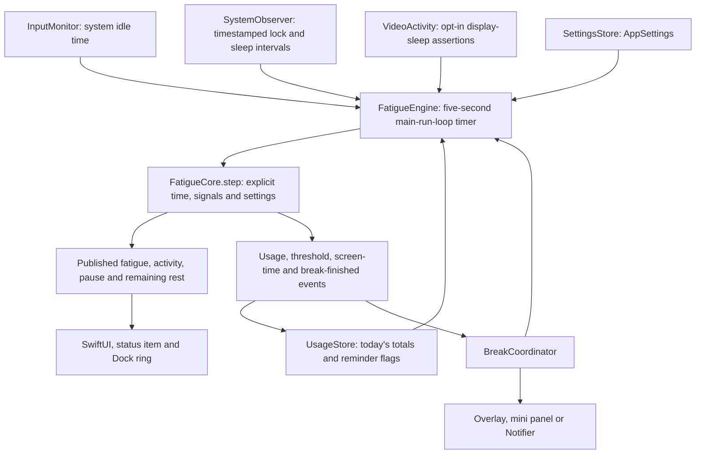
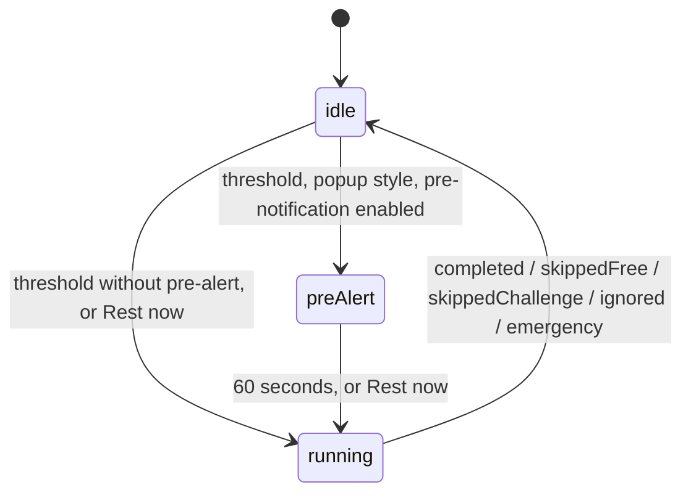

# Architecture

Palpebra has two Swift modules and two test targets, declared in [Package.swift](../Package.swift). There are no third-party dependencies. All targets use Swift 6 language mode and deploy to macOS 13 or later.

## Module map

| Module | Responsibilities | Boundaries |
| --- | --- | --- |
| `PalpebraCore` | Settings and stored records, day keys, history/CSV, analysis buckets, fatigue and break-session state, away intervals, notification/login presentation decisions | Foundation only. No AppKit, SwiftUI, Combine or IOKit. Clocks, calendars, signals, defaults suites and file URLs are supplied by callers. |
| `Palpebra` | AppKit/SwiftUI UI, timers, macOS signals, notifications, global shortcut, login item, observable stores and logging | Owns system integration and the production storage location. `AppDelegate` assembles and injects the object graph. |
| `PalpebraCoreTests` | Swift Testing characterization/regression suites and English-only/no-networking source guards | Uses disposable directories and UserDefaults suites. Never reads the owner's history or settings. |
| `PalpebraTests` | App-adapter regression tests | Injects fake system services; never launches the app or requests real permissions. |

`PalpebraCore` is an internal target, not a published library product. Its cross-module API uses `package` access. See the [contributor rules](../CONTRIBUTING.md#rules). The source tree:

```text
Sources/PalpebraCore/       Foundation-only fatigue/session state, settings, history, day keys and buckets
Sources/Palpebra/           AppKit/SwiftUI app and macOS adapters
  AppDelegate.swift        Object graph, menus and main window
  FatigueEngine.swift      Timer and signals → Core → published state and events
  BreakCoordinator.swift   Pre-alert, delivery and session completion
  BreakOverlay.swift       Full-screen rest screen and skip challenge
  MiniReminder.swift       Floating rest card
  Design.swift             Palette, accent tint, eyelid mark and menu-bar glyph
  Fields.swift             Number and duration fields that clamp typed values
  HotKeys.swift            Global shortcut registration and recording
  PreviewRenderer.swift    Offscreen documentation images (DEBUG only)
Tests/PalpebraCoreTests/    Swift Testing regressions and source-policy checks
Tests/PalpebraTests/        App-adapter tests with injected system services
Resources/                 Bundle plist and original icon artwork
scripts/                   Tests, packaging checks, icon generator and release archives
docs/                      Architecture, releasing guide and README images
```

## Signals and data flow



[FatigueCore](../Sources/PalpebraCore/FatigueCore.swift) reads no clock and starts no timer. `step` returns events; `FatigueEngine` books usage first, publishes only changed values, then delivers reminder/session events. Session start, notification-delivery confirmation and user skip/emergency actions feed back into Core.

Smart mode compares idle seconds with `idleGraceSeconds`; optional display-sleep assertions also count as use. Always on counts use unless locked/asleep. No individual input events or screen contents are observed for detection. `EscapeHoldHandler` handles focused popup key events only for the emergency hold.

[AwayState](../Sources/PalpebraCore/AwayState.swift) unions overlapping lock, display-sleep and system-sleep intervals. The observer keeps wall-clock timestamps; Core applies elapsed rest once on return, without booking screen time. An unexplained sampling gap of 120 seconds or more is dropped unless finite idle evidence covers the entire gap. Missing input samples cannot prove rest. Normal activity/idle slices and recorded away slices are applied in time order.

Fatigue rises by `100 / usageThresholdMinutes` points per active minute and falls by `100 / restMinutes` per counted rest minute, clamped to 0…100. Pauses freeze fatigue but still record actual use. Full-screen sessions freeze it; non-blocking sessions keep it running. Live fatigue, pauses and running sessions are not persisted. The [README](../README.md#how-fatigue-works) explains it with the default settings.

## Break-session state machine

[BreakCoordinator](../Sources/Palpebra/BreakCoordinator.swift) owns delivery phases; Core owns the session's captured style, skip mode, rest duration and deadline in [BreakSession](../Sources/PalpebraCore/BreakSession.swift).



A threshold marks Core as break-running immediately to prevent duplicate reminders during the optional pre-alert. Full-screen fatigue is frozen even during that pending phase. Break starts and reminder counts are recorded when the actual session starts, after the pre-alert. A manual break bypasses or cancels that delay. The pre-alert uses notification permission; a failed pre-alert does not prevent the popup from appearing.

| Style | Completion | Other exits |
| --- | --- | --- |
| Full-screen | Wall-clock countdown reaches the captured rest duration | Explicit free/challenge skip, or hold-Esc emergency in Cannot skip |
| Mini | Fatigue reaches zero through actual rest | Skip/emergency, or `ignored` at rest duration + re-remind interval |
| Notification | Delivery accepted by UserNotifications, then fatigue reaches zero | Immediate `ignored` if denied/failed; otherwise `ignored` at rest duration + re-remind interval |

Notification delivery acceptance does not prove the user saw a banner; Focus and macOS delivery presentation remain outside the model. The retained Notifier installs itself as the notification-center delegate at launch for normal app bundles and requests banner, list and sound presentation in the foreground. Notification sessions have no popup skip controls. Mini panels have no close button and cannot be dismissed with Command-W. Both the full-screen overlay and the mini card are non-activating panels: since macOS 14 the system may decline to activate an app for a break that starts while you work elsewhere, and only a panel can still take the keyboard then. The DEBUG self-test checks exactly that and prints whether the app was activated. A five-second continuous Esc hold in a focused Cannot skip popup records `emergency`; release, focus loss or lock cancels it. Both Quit menus are disabled while a captured Cannot skip popup session runs; OS logout, restart and shutdown are not vetoed. A notification session keeps Quit available: it has no popup, so no hold-Esc emergency exit, and continued work already ends it as ignored.

Only `completed` resets fatigue to zero. Skips, ignored reminders and emergencies preserve it and start the re-remind cooldown at the actual session end. An idle session that starts at zero fatigue can complete on its next sample after delivery is confirmed. A completed full-screen session can finish while locked; non-blocking sessions reconcile timestamped away time on unlock/wake. Activity/rest slices split at a non-blocking session's captured deadline: reaching zero by or exactly at that boundary completes; otherwise it ends as ignored at the deadline and starts its cooldown there. Later rest still lowers fatigue without changing the ended session's outcome, even when processing resumes much later.

Daily screen-time notifications are independent of the fatigue threshold and its cooldown. Each threshold is marked in the daily record when the event is attempted, so it is attempted at most once per day even if alerts are unavailable. The coordinator records all session outcomes and closes popup surfaces when a session ends.

## Persistence

[AppEnvironment](../Sources/Palpebra/AppEnvironment.swift) chooses production paths and defaults before stores are constructed. The current bundle identifier, `org.palpebra.app`, is defined in [Resources/Info.plist](../Resources/Info.plist). A future identifier change needs an explicit settings/permission migration decision; the Application Support path is independent of that identifier.

### History JSON

`~/Library/Application Support/Palpebra/usage.json` is a JSON array of `DayRecord` objects. Example:

```json
[
  {
    "day": "2026-10-25",
    "activeSeconds": 2700,
    "fatiguePeak": 100,
    "fatiguedSeconds": 540,
    "breakStarts": 2,
    "breakFinishes": 2,
    "finishReasons": ["completed", "skippedChallenge"],
    "reminderCount": 2,
    "screenTimeNotifiedPrimary": false,
    "screenTimeNotifiedSecondary": false
  }
]
```

| Field | Meaning |
| --- | --- |
| `day` | Required ASCII Gregorian `yyyy-MM-dd` day key in the supplied calendar's time zone |
| `activeSeconds` | Recorded computer use; excludes lock/sleep/idle rest |
| `fatiguePeak` | Highest fatigue sampled at the start of a booked active interval |
| `fatiguedSeconds` | Active time whose sampled fatigue is at least 80% |
| `breakStarts`, `breakFinishes` | Session starts and all finished outcomes, respectively |
| `finishReasons` | Ordered strings: `completed`, `skippedFree`, `skippedChallenge`, `ignored`, `emergency`; unknown strings survive decoding |
| `reminderCount` | Legacy count retained on disk; duplicates starts and is omitted from UI/CSV |
| `screenTimeNotifiedPrimary`, `screenTimeNotifiedSecondary` | Per-day screen-time notification-attempt flags |

Missing fields other than `day` default to zero, empty or false. Unknown keys are ignored. Completion/compliance is derived from `finishReasons`, never from `breakFinishes`; skipped, ignored and emergency outcomes do not count as completed. Starts and finishes are booked on the day each occurs, so a midnight-spanning session can put them on different days. Compliance is clamped to 0…100%, with zero when there are no starts in the selected range. Decoded numeric values must be finite and nonnegative. Each duration allows up to 604,800 seconds (seven days, deliberately generous for clock changes and legacy merges), fatigue peaks up to 100, and counters up to 1,000,000. Records outside these bounds enter the same lossy recovery path as malformed records. UI whole-number labels also guard non-finite and out-of-range conversions before converting to Int.

[UsageHistory](../Sources/PalpebraCore/UsageHistory.swift) loads valid records individually. Damaged input is moved to `usage.corrupt-<epoch-milliseconds>[-<collision-index>].json` before replacement; valid recovered records are saved immediately. A fully invalid document starts fresh only after its original is preserved. Read or backup failure disables saving for that app session. Clear History atomically writes an empty array and leaves recovery backups in place. Each save rewrites the whole file atomically, so saves are coalesced to at most one every two minutes while usage accumulates; locking or sleeping the Mac and quitting flush pending changes sooner. Canonical records older than 370 days are pruned on load; unparseable legacy day keys and recovery files remain.

[DayKey](../Sources/PalpebraCore/DayKey.swift) writes keys with a locked cached POSIX/Gregorian formatter and parses them with Gregorian calendar arithmetic, both in the caller-supplied time zone. Parsing returns the real start of days whose midnight a DST change skips or repeats, which a strict formatter rejects or misplaces. Load migration attempts the legacy current-locale date format, merges collisions by summing counters and durations, keeping the greatest peak and OR-ing flags, and preserves unparseable records. Analysis groups by actual bucket start dates, orders chronologically and labels buckets in English, such as `Mon, Oct 20`, `Week of Oct 19` and `Oct 2026`, adding years when the range spans more than one. Its daily averages count only days with recorded use.

CSV is exported from Settings, to a user-selected location. It has nine columns, in this order:

```text
date,active_minutes,fatigue_peak_percent,fatigue_peak_minutes,break_starts,break_finishes,breaks_completed,breaks_skipped,compliance_percent
```

Minutes use one decimal place, the peak uses whole percent, and compliance is truncated to an integer percent. `break_finishes` includes every outcome, and `fatigue_peak_minutes` counts use at 80% fatigue or more. `breaks_completed` counts only completed outcomes; `breaks_skipped` combines the two skip reasons. The former `reminders` CSV column is removed; the stored JSON counter remains. CSV does not have separate ignored/emergency columns.

### Preferences and image

SettingsStore encodes `AppSettings` as JSON `Data` in the app's UserDefaults domain. The persisted keys are centralized in [DefaultsKey](../Sources/PalpebraCore/DefaultsKey.swift):

| Key | Payload and migration |
| --- | --- |
| `palpebra.settings.v2` | Current JSON settings, including `restHotkey` |
| `palpebra.settings.v1` | Read fallback if v2 is absent or cannot decode |
| `palpebra.restHotkey` | Legacy optional combo JSON; migrated once into v2 and removed after successful save |
| `palpebra.onboarded` | Bool indicating the initial main window was shown |

Missing or malformed settings fields and unknown enum raw values get per-field defaults; unknown keys are ignored. An unreadable document is copied byte for byte to `<source-key>.corrupt-<ISO-8601-timestamp>[-<collision-index>]` before trying the older key/defaults or saving any edits or shortcut migration. SettingsStore exposes recovery keys and logs each backup. Numeric bounds live in `SettingLimits` in [Models.swift](../Sources/PalpebraCore/Models.swift): decoding clamps stored values to them (full-screen brightness to 0.25…1), and the number fields in Rules, Detection and Settings clamp typed values to the same ranges. Old `channels` values remain decodable and round-trip; `channels.screenChanges` initializes `countVideoPlayback` only if the new field is absent. Individual input channels no longer affect detection. The persisted detection raw value `dumb` is labeled **Always on** in UI. Legacy `statusShowsReminderCount` and `launchAtLogin` fields survive round trips; login UI reads SMAppService's actual status rather than trusting that stored flag.

`CustomBackground` copies the chosen image bytes to `~/Library/Application Support/Palpebra/popup-background` without an extension, validates them as an NSImage and caches the decoded image. Successful adoption/removal publishes the new image immediately. File-action failures are logged and shown as alerts where user-initiated. Deletion and privacy guidance is in the [README](../README.md#privacy).

## Appearance

The violet follows macOS's rule for app accent colors: it tints controls while the system accent is Multicolor, and an accent the user picks in System Settings wins. Declaring an accent in the bundle needs an asset catalog compiled by Xcode, so `AccentPreference` reads the global `AppleAccentColor` default instead and the main window tints its controls with `appTint`. The window's tabs are a segmented control because `TabView` ignores the tint, and push buttons stay gray as they do under a native accent. Focus rings, text selection and menu highlights are drawn by macOS in the system accent.

## Threading and development tools

UI, observable stores, timers and system adapters are `@MainActor`. Core values use checked `Sendable` conformance; they are stepped synchronously on the main actor by the app. Main-run-loop timer callbacks assert main-actor isolation; notification callbacks hop to `MainActor` before accessing UI state. Notification settings are reduced to a Sendable value before crossing that boundary. `NotificationCenterClient` explicitly requires `@Sendable` handlers, including when the installed SDK's Objective-C API lacks those annotations. Its system adapter is nonisolated at callback registration, so callbacks cannot inherit `MainActor` accidentally. Tests deliver fake authorization/settings responses on a background queue without accessing the real notification center. Foundation observer-registration owners remove tokens from their issuing centers on teardown. File I/O is currently synchronous; no background persistence queue is used.

Palpebra runs all day, so idle work is kept small. The engine's five-second timer has one second of tolerance so macOS can coalesce its wakeups; Core measures the actual interval, so accounting is unaffected. After each sample the engine publishes only changed values, then sends one `didUpdate` signal; the status item redraws only when its text changes, and the mini reminder counts down between samples from that update. The display-sleep assertion query runs only when Core says it can change the step. The main window's SwiftUI content exists only while the window is open, so a closed window does no work; reopening rebuilds it at the same frame. Closing destroys that view graph, so views must not publish observable changes from teardown callbacks: SwiftUI aborts with an exclusive-access violation. The shortcut recorder's `dismantleNSView` therefore reports the end of recording on the next main-actor turn. A custom background image is decoded once, upright, at the size that fills the connected screens.

The DEBUG renderer, self-test and open-main hooks select a unique temporary directory and UserDefaults suite before constructing stores. They skip notification authorization and login-item mutations and clean up on normal exit. Their code and short QA pause options are excluded from release builds. The renderer uses explicit Aqua and Dark Aqua appearances with an opaque window background. See [DEBUG tools](../CONTRIBUTING.md#debug-tools) for invocation, image names, and the interactive-only tools.
